

  <a href="https://www.aiworkdeck.com/en">
    <picture>
      <source media="(prefers-color-scheme: dark)" srcset=".github/assets/readme/banner-en-dark.webp">
      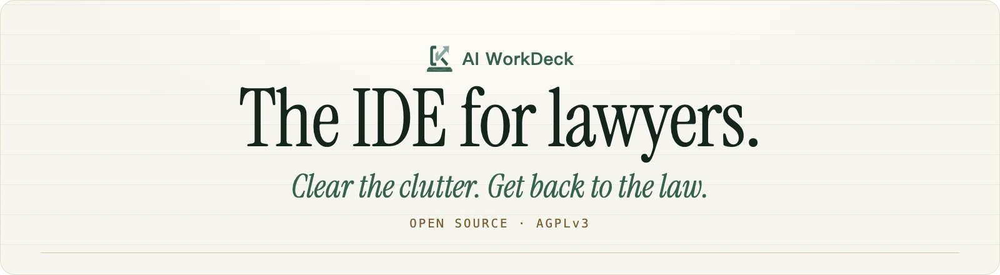
    </picture>
  </a>

  Programmers have long had their IDE: files, editing, search, versions and AI in one window. 
  <strong>AI WorkDeck brings that infrastructure to lawyers</strong> — organised by matter, every answer sourced, every change on the record.

  <a href="https://github.com/AI-WorkDeck/aiworkdeck/releases/latest"><picture><source media="(prefers-color-scheme: dark)" srcset=".github/assets/readme/btn-download-en-dark.png"></picture></a>&nbsp;
  <a href="https://github.com/AI-WorkDeck/aiworkdeck/stargazers"><picture><source media="(prefers-color-scheme: dark)" srcset=".github/assets/readme/btn-star-en-dark.png"></picture></a>&nbsp;
  <a href="https://www.aiworkdeck.com/web?lang=en"><picture><source media="(prefers-color-scheme: dark)" srcset=".github/assets/readme/btn-try-en-dark.png">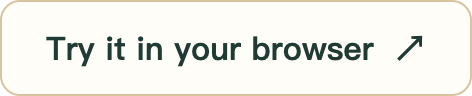</picture></a>

  
  
  
  
   
  Free community edition · Windows / macOS · <strong>English</strong> · <a href="README.zh-CN.md">简体中文</a>

  <a href="https://www.aiworkdeck.com/api/video?id=promo-en">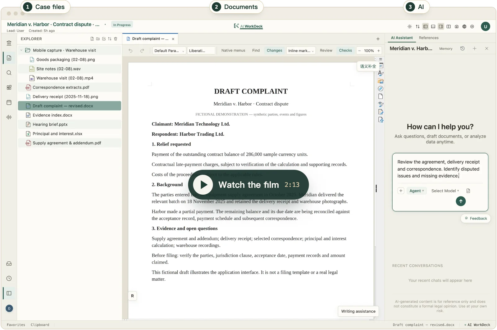</a>
   ▶ Click the screenshot to watch the 2-minute film. Real interface; the matter is fictional.

## Why an IDE

**The AI chat box is the command line of the AI era.** A big matter means hundreds of documents, months of work and several people. Lawyers, like programmers, work in text — piles of files, draft after draft, citations to check everywhere. They deserve their own infrastructure too.

| Chat box | AI WorkDeck |
|---|---|
| Start from scratch every time | The context lives with the matter |
| Paste the materials in, one by one | The AI reads the case file and edits the documents |
| Copy the answers back out, piece by piece | Every step leaves a record |

Just a quick question? Switch to chat mode. For the longer argument, read [our thesis →](WHY.md)

## What it does

<table>
  <tr>
    <td width="50%" valign="top">
      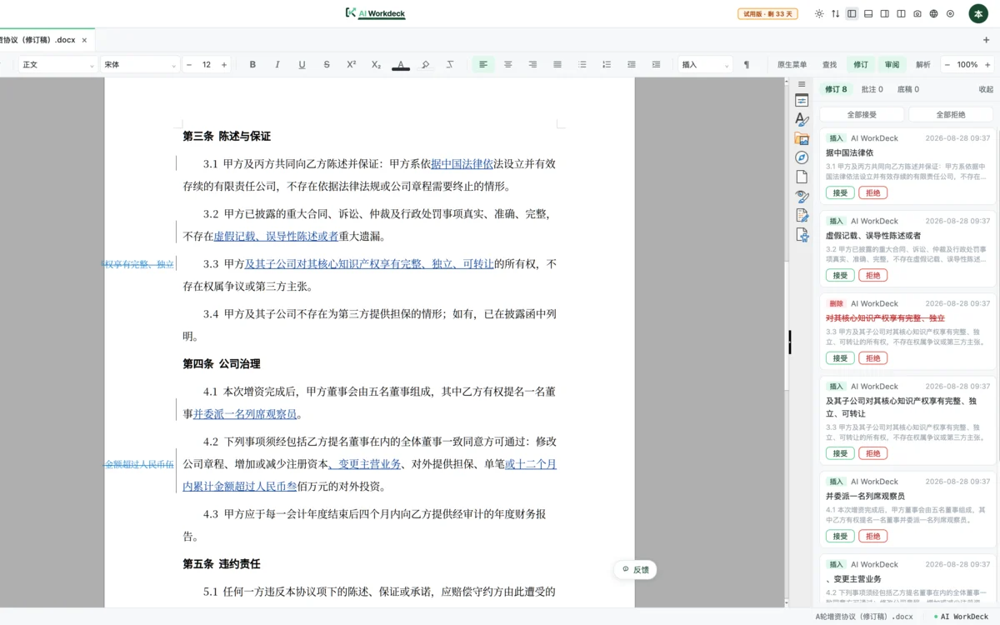
      
<strong>AI edits the document itself.</strong> It writes straight into the real Word file as tracked changes, and you accept or reject each one.

    </td>
    <td width="50%" valign="top">
      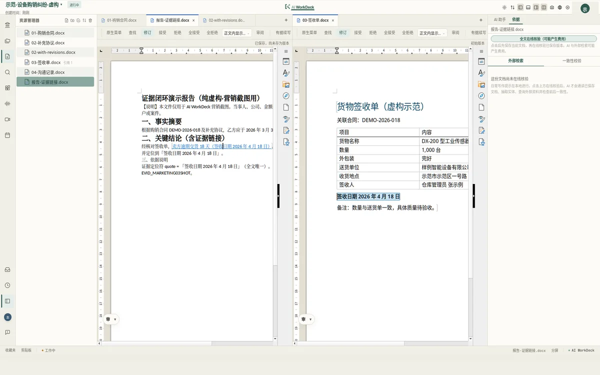
      
<strong>Every conclusion has a source.</strong> Click a citation to land on the supporting passage; changed or missing anchors are flagged.

    </td>
  </tr>
  <tr>
    <td width="50%" valign="top">
      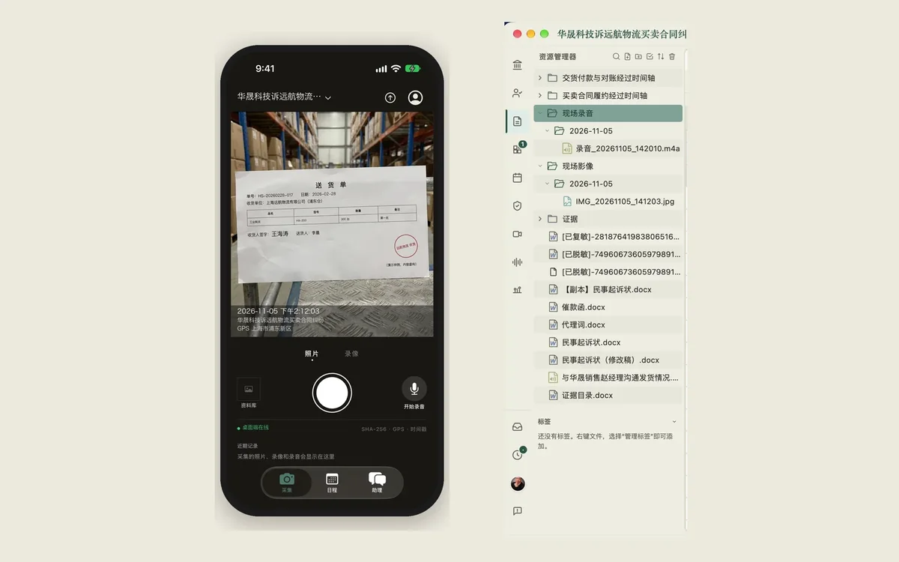
      
<strong>The field and the office, connected.</strong> Photos and recordings taken on your phone land in the matter on your computer, filed by date.

    </td>
    <td width="50%" valign="top">
      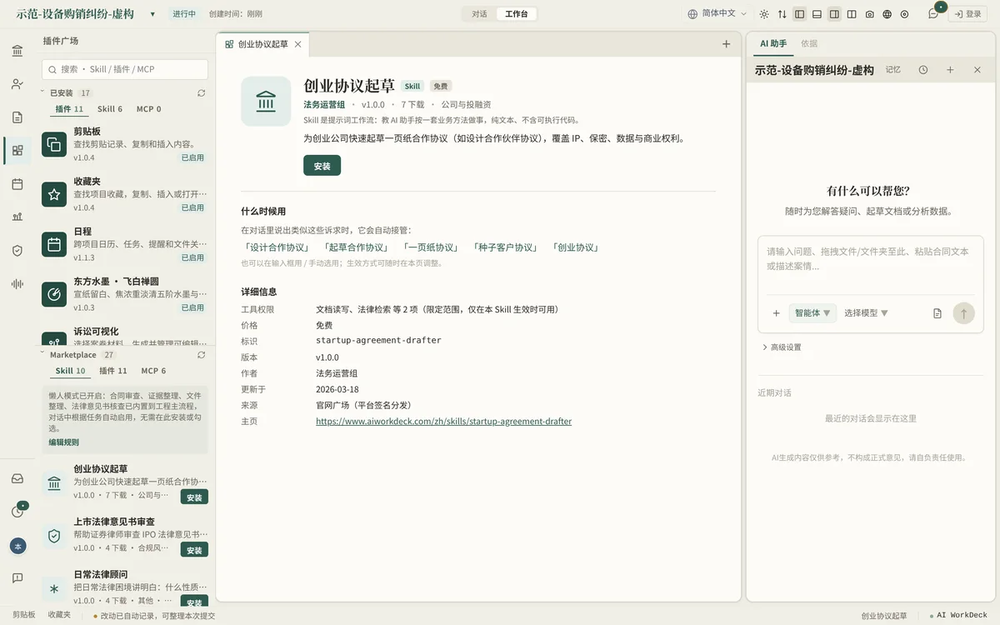
      
<strong>Extended by the community.</strong> Install Skills, plugins and MCP servers in one click — or publish your own; authors keep 85% of net receipts on paid listings.

    </td>
  </tr>
</table>

Screenshots use fictional demo matters. The interface is shown in Chinese; it ships in 20 interface languages.

## Video tutorials

Two minutes, one task — 19 short episodes on the [website](https://www.aiworkdeck.com/en/videos). Tutorials are in Chinese for now.

<table>
  <tr>
    <td width="25%"><a href="https://www.aiworkdeck.com/en/videos">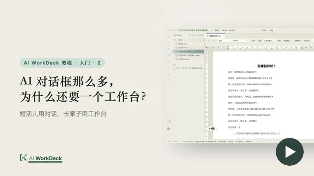</a> Why a workspace?</td>
    <td width="25%"><a href="https://www.aiworkdeck.com/en/videos">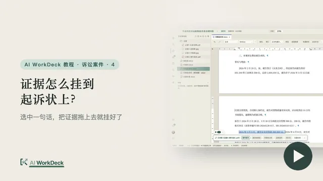</a> Linking evidence into the complaint</td>
    <td width="25%"><a href="https://www.aiworkdeck.com/en/videos">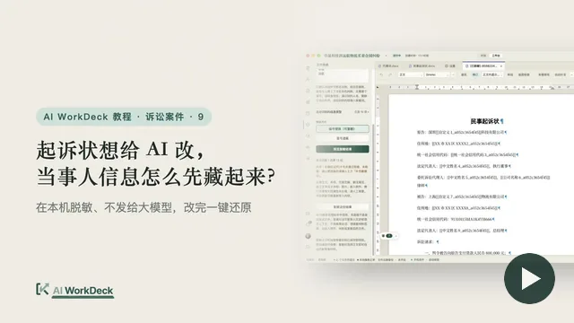</a> Hiding party details before the AI edits</td>
    <td width="25%"><a href="https://www.aiworkdeck.com/en/videos">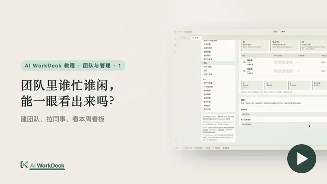</a> Who on the team is busy?</td>
  </tr>
</table>

## Try it

- **Use it:** [macOS / Windows releases](https://github.com/AI-WorkDeck/aiworkdeck/releases/latest) · [try it in the browser](https://www.aiworkdeck.com/web?lang=en) · [website](https://www.aiworkdeck.com/en).
- **Run from source:** [Getting started](docs/getting-started.md) · [Architecture](docs/architecture.md). The contributor stack uses JDK 21, Maven, Node/npm and PostgreSQL; optional sidecars have additional requirements.
- **Know the data paths:** desktop editing uses local storage by default; cloud models, platform services, hosted add-ins and sync have different data paths. Self-hosting requires configuration and deployment-specific verification. See [Privacy and service data flows](legal/PRIVACY.md).

## Build with us

The repository contains the desktop app, workbench, agent backend, document-editor integration and plugin runtime. The foundations map to code you can read:

| Foundation | Where to look |
|---|---|
| Document-native agent edits, tracked changes and checkpoints in the embedded LibreOffice WASM editor | [Editor primitives](docs/AI_EDITOR_PRIMITIVES.md) · [Editor bridge](frontend/src/zetaoffice/) |
| Source links with anchor-change detection; a pluggable evidence-provider interface | [Evidence contract](docs/EVIDENCE_CONTRACT.md) · [Provider example](examples/hello-evidence-plugin/) |
| Git-backed history, three-way document merge, paragraph-level provenance | [Version engine](backend/src/main/java/com/checkba/version/) |
| Web panes, Java tools, declarative templates and reusable Skills | [Plugin guide](docs/plugin-guide.md) · [SDK](sdk/plugin-sdk/) · [Skill spec](docs/SKILL_SPEC.md) · [Examples](examples/) |
| Built-in workflows and entry points | [Skills](backend/skills/) · [Litigation visualization](litviz/) · [Desktop](desktop/) · [Office/WPS add-in](office-addin/) |

**Build a plugin.** Start with the [minimal web plugin](examples/hello-web-plugin/) (plain HTML and JavaScript, no build step) or the [declarative plugin](examples/hello-declarative-plugin/), or let an agent help you through the [developer walkthrough](docs/plugin-developer-journey.md). Web plugins run in a sandboxed iframe behind a permission-checked bridge; Java plugins run in the backend process and must be trusted. The developer program initially has no application fee; basic profile review is not identity certification, and each plugin version undergoes separate review and signing. The [plugin guide](docs/plugin-guide.md) explains the boundaries and the publication process.

**Contribute.** A small reproducible case is especially valuable: a document that loses formatting, a source link that no longer resolves, an edit that fails to round-trip, or an unclear setup step. Use synthetic or redacted materials, and discuss large changes in an [issue](https://github.com/AI-WorkDeck/aiworkdeck/issues) first. Read the [contribution guide](.github/CONTRIBUTING.md). Code contributions require a one-time [CLA](legal/CLA.md); contributors retain copyright and grant the steward dual-licensing rights. Substantial API changes use the [RFC process](GOVERNANCE.md#rfc-process); the [governance model](GOVERNANCE.md) and [maintainers](MAINTAINERS.md) are public. Plugin and Skill authors can publish through the marketplace ([China](https://www.aiworkdeck.com/zh/plugins) · [International](https://www.workdeck.ai/en/plugins)) under the [marketplace terms](legal/MARKETPLACE-TERMS.md); funded tasks follow the [bounty policy](BOUNTIES.md), with availability and amounts set per issue.

**Roadmap** — contribution directions, not dated release commitments: reliable document work on complex layouts, long documents, tracked changes and undo; source links that survive edits; a shorter path for builders (clean local demo, self-hosting docs, more examples); and repeatable professional workflows packaged as Skills. Bring a use case to [Discussions](https://github.com/AI-WorkDeck/aiworkdeck/discussions).

## About

AI WorkDeck is an open-source exploration rooted in day-to-day legal work, developed outside working hours with team support and feedback from colleagues. Its initiator, Zewei Han, is a practicing lawyer and a partner at Beijing Redsunny Law. He previously worked at King & Wood Mallesons, where he supported projects of the firm’s legal technology team, and co-authored 《大模型时代的法律科技》 (on legal technology in the era of large models). Contact: [hi@aiworkdeck.com](mailto:hi@aiworkdeck.com).

## Licensing and stewardship

The steward is **北京京微资易科技有限公司 (Beijing Jingwei Ziyi Technology Co., Ltd.)**; **真善美承泽有限公司 (Zhen Shan Mei Grace Legacy Limited)** operates the international offering. Commercial licensing covers the steward's code; third-party components retain their own terms. See [AGPL-3.0-or-later](legal/LICENSE), [commercial licensing](legal/COMMERCIAL-LICENSE.md), [third-party components](legal/THIRD-PARTY-COMPONENTS.md), and [trademarks](legal/TRADEMARKS.md).

The steward's existing policy allocates **20% of net commercial-licensing revenue** to a community fund for bounties, Skill-creation grants, and community events. This is a public policy that may be adjusted prospectively, not an individual contractual entitlement. Governance roles carry technical authority; economic terms are set separately in the [bounty policy](BOUNTIES.md) and [marketplace terms](legal/MARKETPLACE-TERMS.md).

For licensing needs outside AGPL, contact [hi@aiworkdeck.com](mailto:hi@aiworkdeck.com); the [commercial license](legal/COMMERCIAL-LICENSE.md) sets out the applicable terms.
