

  <a href="https://www.aiworkdeck.com/zh">
    <picture>
      <source media="(prefers-color-scheme: dark)" srcset=".github/assets/readme/banner-zh-dark.webp">
      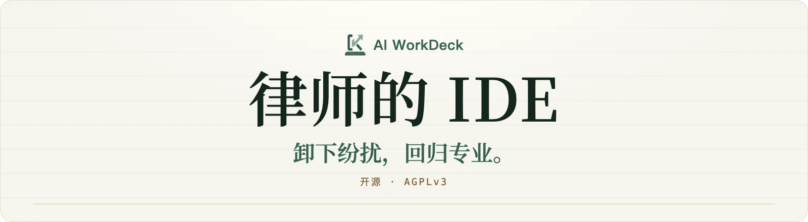
    </picture>
  </a>

  程序员早就有了自己的 IDE：文件、编辑、检索、版本、AI，都在一个窗口里。 
  <strong>AI WorkDeck 把这套基础设施带给律师</strong>——以案为单位，答案标着出处，全程留痕。

  <a href="https://www.aiworkdeck.com/zh/start"><picture><source media="(prefers-color-scheme: dark)" srcset=".github/assets/readme/btn-download-zh-dark.png"></picture></a>&nbsp;
  <a href="https://github.com/AI-WorkDeck/aiworkdeck/stargazers"><picture><source media="(prefers-color-scheme: dark)" srcset=".github/assets/readme/btn-star-zh-dark.png"></picture></a>&nbsp;
  <a href="https://www.aiworkdeck.com/web?lang=zh"><picture><source media="(prefers-color-scheme: dark)" srcset=".github/assets/readme/btn-try-zh-dark.png">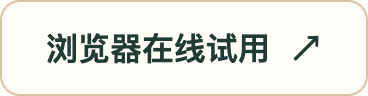</picture></a>

  
  
  
  
   
  社区版免费 · Windows / macOS · <a href="README.md">English</a> · <strong>简体中文</strong>

  <a href="https://www.aiworkdeck.com/api/video?id=promo-zh">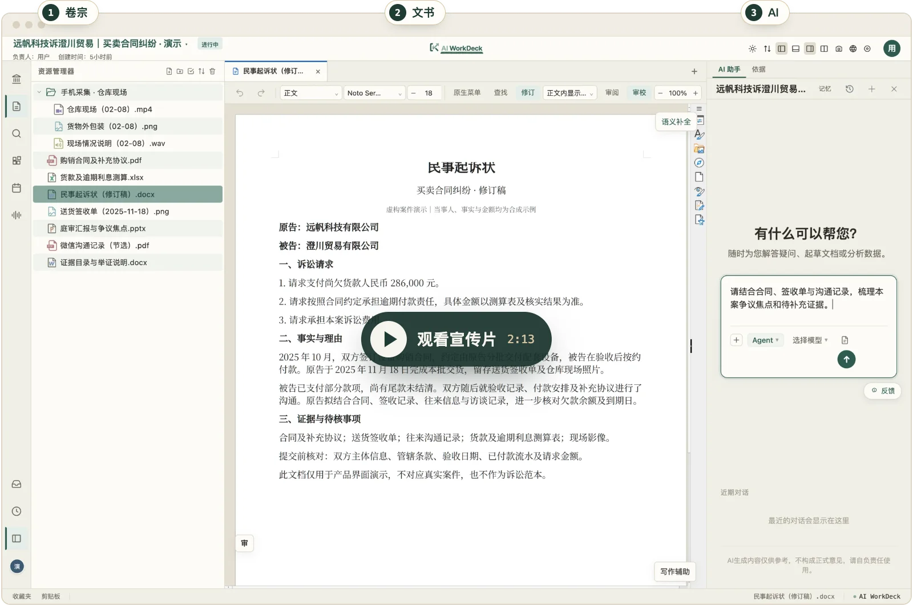</a>
   ▶ 点击截图观看 2 分钟宣传片。真实界面，虚构案件。

## 为什么是 IDE

**AI 对话框，是 AI 时代的命令行。** 一个大案子，几百份材料、好几个月、好几个人。律师和程序员一样靠文字干活，都要管一大堆文件、一稿又一稿的版本，处处引用、处处核对——也该有自己的基础设施。

| 对话框 | AI WorkDeck |
|---|---|
| 每次都要从头说起 | 案子在哪，上下文就在哪 |
| 材料一份份贴进去 | AI 直接读卷宗、改文书 |
| 答案再一段段复制回来 | 每一步都留下记录 |

只是临时问一句？切到对话模式就行。完整的思考见[产品判断 →](WHY.zh-CN.md)

## 它能做什么

<table>
  <tr>
    <td width="50%" valign="top">
      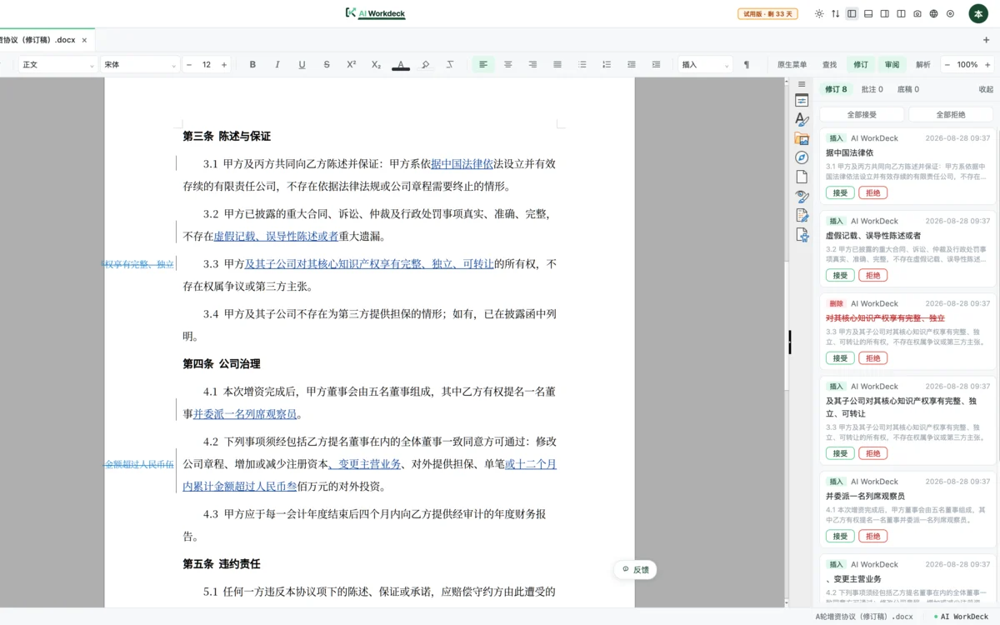
      
<strong>AI 直接改文书。</strong>直接在真实的 Word 文件里落笔，每处改动都留修订痕迹，由你逐条接受或拒绝。

    </td>
    <td width="50%" valign="top">
      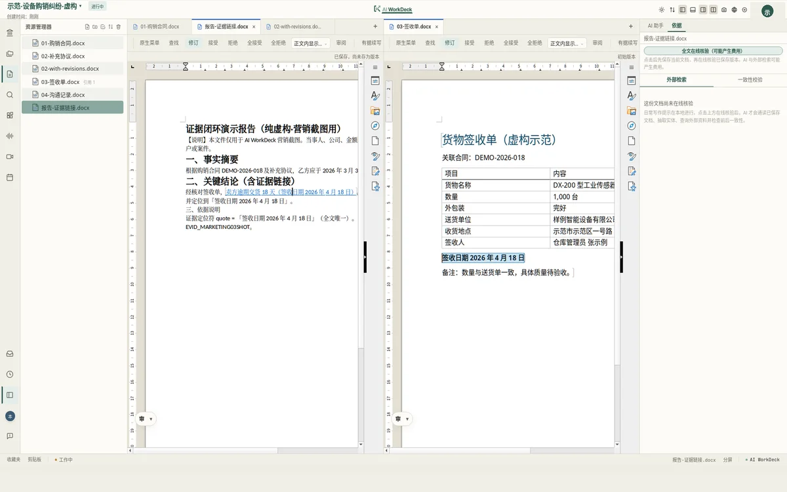
      
<strong>结论标着出处。</strong>点一下引用就落到支撑结论的原文位置；锚点内容变化或丢失会被检测出来。

    </td>
  </tr>
  <tr>
    <td width="50%" valign="top">
      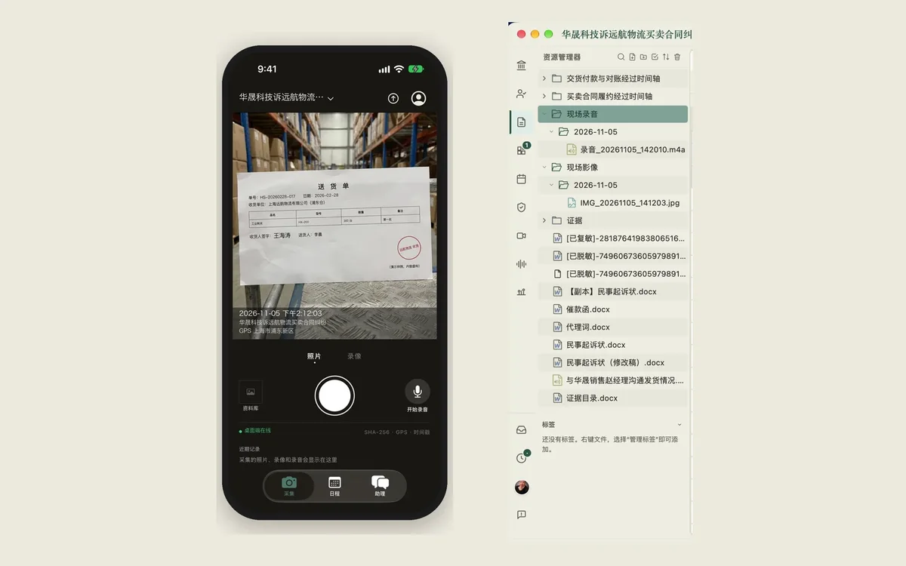
      
<strong>现场和办公室连成一片。</strong>在现场用手机拍照、录音，资料自己回到电脑上的案卷里，按日期归好。

    </td>
    <td width="50%" valign="top">
      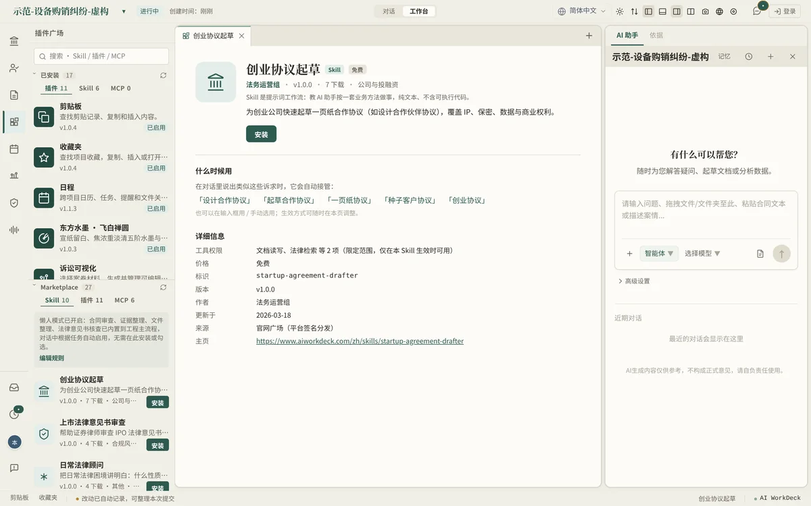
      
<strong>和社区一起扩展。</strong>Skill、插件、MCP 一键安装；也可以上架自己的作品，付费作品作者分得净收入的 85%。

    </td>
  </tr>
</table>

截图均使用虚构演示案件。界面支持 20 种语言。

## 视频教程

两分钟，讲清一件事——共 19 集，见[官网视频教程](https://www.aiworkdeck.com/zh/videos)。

<table>
  <tr>
    <td width="25%"><a href="https://www.aiworkdeck.com/zh/videos">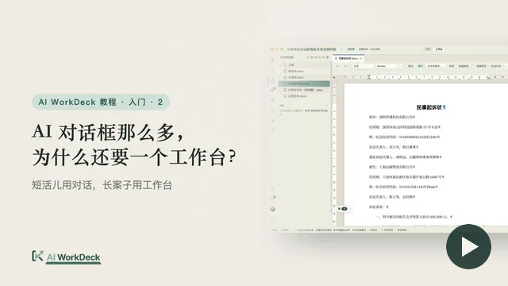</a> 为什么还要一个工作台？</td>
    <td width="25%"><a href="https://www.aiworkdeck.com/zh/videos">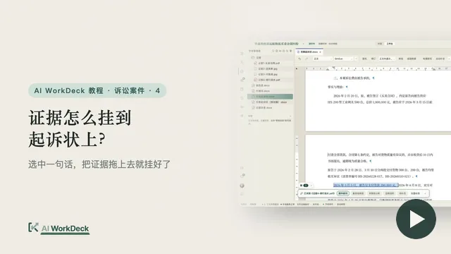</a> 证据怎么挂到起诉状上？</td>
    <td width="25%"><a href="https://www.aiworkdeck.com/zh/videos">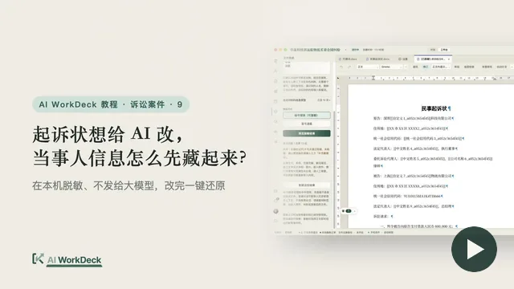</a> 当事人信息怎么先藏起来？</td>
    <td width="25%"><a href="https://www.aiworkdeck.com/zh/videos">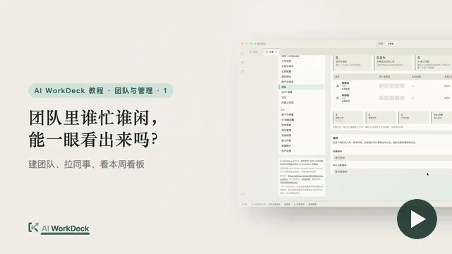</a> 团队里谁忙谁闲？</td>
  </tr>
</table>

## 开始使用

- <strong>直接用：</strong>[下载桌面版](https://www.aiworkdeck.com/zh/start)（[GitHub 安装包](https://github.com/AI-WorkDeck/aiworkdeck/releases/latest)）· [浏览器在线试用](https://www.aiworkdeck.com/web?lang=zh) · [官网](https://www.aiworkdeck.com/zh)。
- <strong>从源码运行：</strong>[开发入门](docs/getting-started.md) · [技术架构](docs/architecture.md)。贡献者环境使用 JDK 21、Maven、Node/npm 和 PostgreSQL；可选服务另有依赖。
- <strong>核对数据流向：</strong>桌面编辑默认使用本地存储；云端模型、平台服务、托管加载项和同步各有数据路径，私有部署需要结合配置逐项验证。详见[隐私与服务数据说明](legal/PRIVACY.md)。

## 一起建设

本仓库包含桌面应用、工作台、智能体后端、文档编辑器集成和插件运行时。各项基础能力都可以对照代码查看：

| 基础能力 | 查看实现 |
|---|---|
| 直接操作文档的智能体：在内嵌 LibreOffice WASM 编辑器中细粒度修改、保留修订，并可从检查点恢复 | [编辑原语](docs/AI_EDITOR_PRIMITIVES.md) · [编辑器桥接](frontend/src/zetaoffice/) |
| 能检测锚点变化的依据关联；可扩展的证据提供方接口 | [依据关联契约](docs/EVIDENCE_CONTRACT.md) · [提供方示例](examples/hello-evidence-plugin/) |
| 基于 Git 的历史、三方文档合并、段落级来源归属 | [版本引擎](backend/src/main/java/com/checkba/version/) |
| 网页面板、Java 工具、声明式模板与可复用 Skill | [插件指南](docs/plugin-guide.md) · [SDK](sdk/plugin-sdk/) · [Skill 规范](docs/SKILL_SPEC.md) · [示例](examples/) |
| 内置工作流与进入现有工作的入口 | [Skills](backend/skills/) · [诉讼可视化](litviz/) · [桌面端](desktop/) · [Office/WPS 加载项](office-addin/) |

<strong>开发插件。</strong>从[最小网页插件](examples/hello-web-plugin/)（普通 HTML 和 JavaScript，无需构建）或[声明式插件](examples/hello-declarative-plugin/)开始，也可以跟着[外部开发者完整指南](docs/plugin-developer-journey.md)让 Agent 帮你写。网页插件运行在沙箱 iframe 中，通过检查权限的桥接接口调用宿主；Java 插件在后端进程中运行，需要信任其代码。初期开发者申请不收费；基本资料审核不等于实名或机构资质认证，每个插件版本另行审核、签名。[插件指南](docs/plugin-guide.md)说明了这些边界和发布流程。

<strong>参与贡献。</strong>一个小而可复现的问题尤其有价值：某份文档丢失了格式，某条依据无法重新定位，某次修改保存后重开不一致，或者某个安装步骤不够清楚。请使用合成或适当脱敏的材料；较大的改动先在 [Issue](https://github.com/AI-WorkDeck/aiworkdeck/issues) 中讨论范围。提交前阅读[贡献指南](.github/CONTRIBUTING.md)。代码贡献需一次性签署 [CLA](legal/CLA.md)：贡献者保留著作权，并授权项目管理方按开源与商业许可两种方式分发。重要 API 改动走 [RFC 流程](GOVERNANCE.md#rfc-process)；[治理规则](GOVERNANCE.md)与[现任维护者](MAINTAINERS.md)公开列明。插件与 Skill 作者可以通过广场发布作品（[中国站](https://www.aiworkdeck.com/zh/plugins) · [国际站](https://www.workdeck.ai/en/plugins)），按[广场条款](legal/MARKETPLACE-TERMS.md)执行；单项资助任务见[悬赏政策](BOUNTIES.md)，是否开放及具体金额以对应 Issue 为准。

<strong>下一步</strong>——参与方向，不是带有确定日期的发版承诺：复杂排版、长文档、修订与撤销的可靠文档操作；修改后仍能定位的依据；更短的开发起步路径（本地演示、私有部署说明、更多插件样例）；把范围明确的专业流程做成 Skill。欢迎带着具体场景来 [Discussions](https://github.com/AI-WorkDeck/aiworkdeck/discussions)。

## 关于项目

AI WorkDeck 是一项源于一线法律工作、在工作之余开展的开源探索，得到团队支持，并在同事的实践反馈中逐步完善。发起人韩泽伟是一名执业律师，曾在金杜律师事务所工作并支持所内法律科技团队的项目，现为 Beijing Redsunny Law 合伙人，也是《大模型时代的法律科技》的合著者。联系：[hi@aiworkdeck.com](mailto:hi@aiworkdeck.com)。

## 许可与项目管理

项目管理方为<strong>北京京微资易科技有限公司</strong>，国际业务由<strong>真善美承泽有限公司（Zhen Shan Mei Grace Legacy Limited）</strong>运营。商业许可覆盖管理方拥有权利的代码，第三方组件仍遵循各自条款。详见 [AGPL-3.0-or-later](legal/LICENSE)、[商业许可](legal/COMMERCIAL-LICENSE.md)、[第三方组件](legal/THIRD-PARTY-COMPONENTS.md)与[商标说明](legal/TRADEMARKS.md)。

管理方现行政策将<strong>商业许可净收入的 20%</strong>用于社区基金，支持悬赏、Skill 创作资助与社区活动。这是一项可向未来调整的公开政策，不构成对个人的合同性权益承诺。治理角色对应技术权限，经济安排另按[悬赏政策](BOUNTIES.md)与[广场条款](legal/MARKETPLACE-TERMS.md)执行。

如有 AGPL 之外的授权需求，请联系 [hi@aiworkdeck.com](mailto:hi@aiworkdeck.com)，具体权利义务以[商业许可](legal/COMMERCIAL-LICENSE.md)为准。
