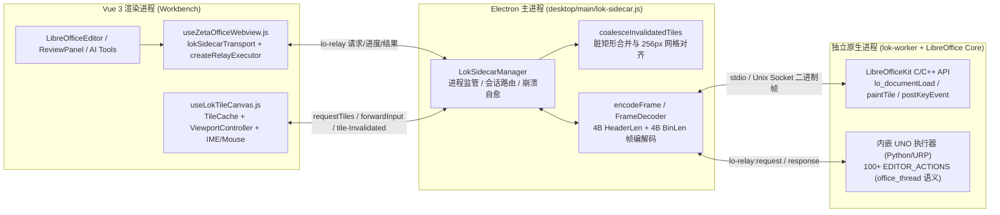

<!-- SPDX-FileCopyrightText: 2026 北京京微资易科技有限公司 and AI WorkDeck contributors -->
<!-- SPDX-License-Identifier: AGPL-3.0-or-later -->

# AI WorkDeck 桌面端原生 LibreOfficeKit (LOK) Sidecar 与双引擎平滑演进技术规范

- **关联议题**：`zeweihan/dev-board#1371`
- **日期**：2026-10-20
- **状态**：架构规范与 Phase 2 桥接底座落地（双引擎同契约并存）
- **上游参考**：ElyOffice `v0.1.8`（commit `0d991e1c715859abd1282981fd46989e7e2319c7`，`AGPL-3.0-or-later`，`crates/ely-lok` & `patches/libreoffice/0001..0029`）

---

## 1. 背景与动机：为什么桌面端演进为 Native LOK Sidecar + Web 端保留 LOWA

AI WorkDeck 当前在桌面端（Electron `<webview>`）与 Web 服务器端（同源 `<iframe>`）统一运行自建的 **LibreOffice WASM（LOWA，`24.2.8-zhcn-r5`）**。这一架构验证了完整的法律文书修订闭环，但在桌面端重度办案场景（双栏分屏比对、150+ 页招股书/尽调底稿、8 GiB 内存轻薄本）下暴露出 Emscripten/WASM 固有的物理天花板：

### 1.1 内存占用对比（~426 MB 单进程多视图 vs 1.3–1.6 GiB / 实例）

| 维度 | 现行桌面端 LOWA (`<webview>` + WASM) | 目标桌面端 Native LOK Sidecar (`lok-worker`) |
|---|---|---|
| **单实例常驻 RSS** | **1.3 – 1.6 GiB**（独立 Chromium Renderer + V8 + Emscripten 固定 1 GiB 线性堆 + MEMFS 字体副本） | **~426 MB**（单个原生 `soffice` 宿主进程，OS 共享库代码段映射） |
| **多文档/分屏并存成本** | 每个保活实例独立 `<webview>`，3 份大文档吃满 **2.4 – 3.5 GiB**；8 GiB 机器被迫在 `librePool.js` 锁死 `LOW_MEMORY_INSTANCE_BUDGET = 2`（dev-board#721） | 单进程多文档/多视图（`lo_documentLoadWithOptions` + `createView` / `setView`），每多开一份文档仅增加 **15 – 45 MB** 模型堆 |
| **最大寻址空间** | 受限于 wasm32 4 GiB 寻址上限与固定堆上限（#1121 连续载入 32 次未释放即触顶 OOM） | 原生 64 位寻址（macOS `arm64`/`x86_64`、Windows `x64`、Linux `x86_64`），支持数千页密集修订比对 |

### 1.2 冷启动耗时（1.1s vs 4–8s）

- **LOWA 冷启动（4 – 8s）**：需经历本地 HTTP 拉取 `soffice.wasm`（45.5 MB br 解压后 ~150 MB）与 `soffice.data`（20.9 MB br）、V8 WebAssembly 编译或代码缓存反序列化、往 MEMFS 写入随包与本机启用字体、启动 pthread worker 并初始化 Qt5 WASM VCL 插件。为此项目不得不维护复杂的后台预热备胎（`libreSpares`，PR#220）与探活自愈状态机（#539/#1018）。
- **Native LOK Sidecar 冷启动（0.7 – 1.1s）**：直接由 OS 动态链接器加载本地 `libmergedlo` / `soffice` 共享库，配合词典裁剪（仅保留必要词典，对比 ElyOffice `PERF-01` 实测从 5.4s 降至 1.1s，二次热启 0.7s），无需后台挂隐藏 `<webview>` 备胎即可在 1 秒级打开文档。

### 1.3 本机字体零拷贝直通（`CoreText` / `DirectWrite` vs 80–120 MB MEMFS 注入）

- **LOWA 痛点**：WASM 沙箱看不见宿主机字体，必须由 `desktop/main/system-fonts.js` 扫描系统字体目录、流式解析 `sfnt` 表，再由 `zetaoffice-server.js` 经 `/sysfonts/f/<id>` 路由把动辄 80–120 MB 的中文字体（如仿宋_GB2312、方正小标宋、思源宋体 TTC）完整读入内存并注入每个 `<webview>` 的 Emscripten MEMFS。
- **Native LOK 优势**：原生 VCL 直接调用 macOS **CoreText**、Windows **DirectWrite**、Linux **fontconfig/FreeType**，零拷贝枚举并渲染系统已安装的任意公文/律所专有字体，彻底省去跨进程搬运百兆字体文件的 I/O 与内存开销。

### 1.4 双引擎长期分工

- **桌面端（Electron）**：支持通过 `AWD_EDITOR_ENGINE=lok`（及后续设置项）切换至 **Native LOK Sidecar + Web Canvas Tile Renderer**，默认保持 `webview`（LOWA）以保障存量版本 100% 向后兼容与灰度对比。
- **Web 端（纯浏览器 / 鸿蒙 Web）**：继续使用 **LOWA (`kind: 'iframe'`)**，两套引擎在宿主侧共享完全一致的 `host.zetaoffice.getEditor()` 与 `lo-relay` (`executeCommand`) 契约。

---

## 2. 进程与 IPC 架构设计（借鉴 ElyOffice `crates/ely-lok`）

桌面端 Native LOK 采用 **Electron 主进程监管（Supervisor）+ 独立原生子进程（`lok-worker`）+ 渲染层 Canvas 图块合成器** 的三层隔离架构，吸收 ElyOffice `crates/ely-lok`（`worker.rs`、`events.rs`、`view.rs`、`view/lane.rs`、`ipc.rs`）经过真机验证的设计精髓：



### 2.1 双通道定长前缀二进制帧协议（`encodeFrame` / `FrameDecoder`）

为避免将 256×256×4 字节（256 KiB）的 RGBA/BGRA 像素图块做 Base64 编码带来的 33% 体积膨胀与序列化抖动，`desktop/main/lok-sidecar.js` 与 `lok-worker` 之间采用 **8 字节小端序双长度头 + UTF-8 JSON 控制头 + 原始二进制载荷** 的流式帧格式（演进自 `ely-ipc` 的 `write_frame` / `read_capped`）：

```text
+-----------------------+-----------------------+-------------------------+-------------------------+
| headerByteLength (4B) | binaryByteLength (4B) | JSON Header (UTF-8)     | Binary Payload (Raw)    |
| uint32le              | uint32le              | headerByteLength bytes  | binaryByteLength bytes  |
+-----------------------+-----------------------+-------------------------+-------------------------+
```

- **上限保护（`MAX_FRAME_BYTES = 64 MiB`）**：与 `ely-ipc::MAX_FRAME` 一致，解码器在分配缓冲区前先校验 `headerByteLength + binaryByteLength <= 64 MiB`，防止异常帧触发主进程 OOM。
- **粘包与半包流式重组（`FrameDecoder`）**：`stdout` / socket 的 `data` 事件可能将一帧拆成多段或将多帧粘合在一个 `Buffer` 中，`FrameDecoder.push(chunk)` 以增量状态机无损切分还原 `{ header, binaryPayload }`。
- **通道语义复用**：
  - **控制与 AI 命令通道**：`binaryPayload` 长度为 0（或附带 `load_document` / `export_document` 的 DOCX 原始字节），`header` 承载 `{ type: 'lo-relay:request', id, sessionId, action, params }`。
  - **图块渲染通道**：`header` 承载 `{ type: 'tile:paint:ok', reqId, sessionId, col, row, xTwips, yTwips, widthTwips, heightTwips, pixelWidth, pixelHeight, generationId, format: 'rgba' }`，`binaryPayload` 直接承载 `256 * 256 * 4` 字节像素缓冲。

### 2.2 事件主动推送（`Feed`）与脏矩形图块合并（`TileCoalescer`）

ElyOffice 在 `agents.md`（2026-10-05 实测记录）中证明：若客户端以长轮询持 worker 锁拉取 LOK 事件，按键等待中位数达 290ms、峰值 9s。因此本架构遵循以下准则：

1. **Worker 主动推送事件（Unasked Events）**：
   - `lok-worker` 注册 `registerCallback`，在后台线程收集 `LOK_CALLBACK_INVALIDATE_TILES`、`LOK_CALLBACK_INVALIDATE_VISIBLE_CURSOR`、`LOK_CALLBACK_TEXT_selection`、`LOK_CALLBACK_STATE_CHANGED`、`LOK_CALLBACK_REDLINE_TABLE_SIZE_CHANGED` 等回调。
   - 每次产生脏矩形时递增该文档会话的 `generationId`（对应 `ely-lok` 的 `batch.generation`），并主动向主进程推送 `event:invalidate_tiles` 帧，绝不阻塞输入队列。
2. **脏矩形对齐与去重合并（`coalesceInvalidatedTiles`）**：
   - Writer 在一次段落输入或修订切换中常连续发出数十个局部重叠的 `INVALIDATE_TILES` 矩形（单位 twips）。
   - `coalesceInvalidatedTiles(rects, tileSizeTwips, docSizeTwips)` 先裁剪至文档合法边界 `[0, docWidthTwips] × [0, docHeightTwips]`，过滤空矩形，并将所有脏矩形投影到固定 `tileSizeTwips`（默认 `256px * 15 twips/px = 3840 twips`）的二维网格 `(col, row)` 上去重排序，输出最小重绘集合 `{ col, row, xTwips, yTwips, widthTwips, heightTwips, key }`。
3. **输入优先与世代号淘汰（`view/lane.rs` + `generationId`）**：
   - 遵循 `ely-lok/src/view/lane.rs` 的 `select_biased!` 调度原则：键盘/鼠标/AI 命令优先级高于后台图块重绘（`inputs first, then tiles`）。
   - 当用户缩放（Zoom）或快速滚动使 `generationId` 前进时，仍在途的旧世代图块返回后被 `TileCache` 立即丢弃（`tile.generationId < currentGeneration`），绝不用过期比例尺覆盖当前画布；同一位置的新图块未落地前保留旧图块（标记 `stale: true`），杜绝打字白闪。

### 2.3 单 Worker 多视图池化替代多 `<webview>` 实例池

- 在現有 `librePool.js` 中，桌面端为了同时保活左/右分屏及后台文档，不得不挂载多个 `<webview>`（每个都是完整的 Chromium 渲染进程 + WASM 实例）。
- 在 Native LOK 模式下，单个 `lok-worker` 进程通过 `sessions` 映射表管理多个 `sessionId`（对应 `pane:fileId`）：
  - 不同文档调 `lok->documentLoadWithOptions` 获得独立 `LokDocument*` 句柄；
  - 同一文档的分屏对照直接调 `doc->createView()` + `doc->setView(viewId)`；
  - 每次执行命令或绘制图块前，像 `ely-lok/src/worker.rs` 的 `with_doc` 一样先 `doc.activate()` 绑定目标视图（防止 Calc/Writer 多文档串视图，配合补丁 `0002-lok-dispatch-to-document-frame.patch` 将 `.uno:` 派发钉死在文档自身 `XFrame` 上）。

---

## 3. 100% 保留 AI WorkDeck 差异化 UNO AI 桥接能力（`office_thread.js` 契约）

单纯的 LibreOfficeKit C API（`postUnoCommand` / `getCommandValues`）只能满足传统查看器或简单编辑，**无法支撑 AI WorkDeck 赖以立身的 100+ `EDITOR_ACTIONS` 深度法律 AI 原语**。因此，Native LOK Sidecar 的核心架构红线是：**渲染走 LOK 图块，而命令执行 100% 保持 `office_thread.js` 的 UNO 语义与 `lo-relay` 报文契约**。

### 3.1 `lo-relay` 零改动透传协议

前端 `useZetaOfficeWebview.js` 新增 `lokSidecarTransport(sidecarBridge, sessionId)` 与 `createLokSidecarEditorExecutor(sidecarBridge, opts)`，底层依然调用同一个 `createRelayExecutor`（`zetaOfficeRelay.js`）：

- **上行请求**：`{ __lo: 'lo-relay', type: 'exec', reqId, action, params, waitForCompletion? }`
- **下行进度**：`{ __lo: 'lo-relay', type: 'progress', reqId, done, total, stage? }`
- **下行结果**：`{ __lo: 'lo-relay', type: 'result', reqId, result }`
- **生命周期信号**：`{ __lo: 'lo-relay', type: 'ready' }` 与 `{ __lo: 'lo-relay', type: 'engine-failed' }`

这意味着上层 `useEditorBridge.js`、`agentClientActions.js`、`LibreOfficeEditor.vue`、`ReviewPanel.vue`、`EvidencePanel.vue` 以及后端 `EditorBridgeService.java` 的 **89+ `@Tool` 方法无需修改任何一行业务代码**。

### 3.2 关键自研原语在 Native LOK Worker 内的实现机制

在 `lok-worker` 内部，除了 LOK C API 渲染循环外，挂接内嵌 UNO 运行时（Embedded Python UNO / C++ UNO ComponentContext `cppu::defaultBootstrap_InitialComponentContext`），直接访问 `SfxBaseModel` 对应的 `css::frame::XModel`，逐项兑现 `office_thread.js` 的核心契约：

1. **字符级 Myers Diff 最小颗粒度修订（`minimalEdits` + `applyMinimalRedline`，dev-board#365）**：
   - 在 `modify_paragraph`、`find_replace`（散点改动分支）、`replace_at_position`、`replace_selection`、`table_set_cell` 中，先裁剪公共前后缀，运行 O((N+M)·D) 的字符级 Myers diff（上限 `D=2000`，单字巧合相同自动合并），在 `lockModel()` / `unlockModel()`（`lockControllers` + 暂停修改广播）保护下**从右向左**逐片段移动 `XTextCursor` 执行删+插，生成精准的字符级 Redline，并按 `params.__agent` 切换 `/org.openoffice.UserProfile/Data` 的 `givenname`（`"AI WorkDeck"` vs 登录用户名 `humanAuthor`）。
2. **两类书签生命周期隔离（`__ai_anchor_*` vs `EVID_*`，dev-board#103 / #1206 / K9）**：
   - `find_text_locations` 在匹配区间对应的 `range.getText()`（兼容正文与表格单元格 `XText`）上创建 `__ai_anchor_N` 书签，**回读 `bm.getName()` 真实书签名**并保存匹配原文快照；`set_selection` / `replace_at_position` 核对当前最终文本与快照一致才放行，`load_document` 时由 `dropAiAnchors()` 统一清场。
   - `bookmark_selection`、`get_bookmark_context`、`check_link_anchors`、`adopt_legacy_links`、`goto_bookmark` 维护持久化进 DOCX 的 `EVID_<ULID>` 底稿证据书签。
3. **内联全部修订视图下的最终文本读取守卫（`runAgentCommandInMarginView`，dev-board#604 / #725 / #1082）**：
   - 默认显示视图保持 `all`（内联全部修订）；当执行带 `__agent: true` 的命令或 `FINAL_TEXT_ACTIONS`（如 `get_document_text`、`capture_writing_context`、`seedDocument`）时，先通过模型属性 `RedlineDisplayType = 0`（`final`）临时隐藏已删除文字（不触碰控制器级 `ShowChangesInMargin` 以免触发视口回滚文首 #604），读取/写入完成后恢复原显示态，并补一次 `paragraphTextOf(ctrl.getViewCursor())` 刷新原生光标屏幕坐标缓存（#725）。
4. **原生审阅几何与装订线动态宽度（`AwdReviewGeometry` / `AwdReviewSidebarWidth`，dev-board#587 / #725）**：
   - 继承本仓 `0003-writer-native-review-geometry.patch`，`get_review_layout` 直接从 Writer C++ 布局层读取 `AwdReviewGeometry`（含 `SwRangeRedline::GetId` 稳定身份与页边/正文物理矩形）与 `AwdReviewSidebarWidth`（0 / 280 对称迟滞控制），无需在打字热路径上逐条枚举 UNO `XRedlines`。
5. **三方合并比对稿生成（`build_merge_draft` / `merge_take_other`，dev-board#630 / #1120 / #1123）**：
   - 在同一条命令内完成「载入另一侧扫描格式指纹 → 载入基线 → 载入主线并 `hideNativeChrome()` + `.uno:CompareDocuments` → 段序对齐核对（`stage: 'align'` 严苛校验）→ 切换作者从后往前重放无冲突块 → 恢复 `humanAuthor`」；原生进程脱离了 1 GiB WASM 堆限制，可直接应对数千页密集修改合同的比对与导出。

---

## 4. 分阶段实施路线图（Phased Rollout Plan）

### Phase 1：内核补丁吸收与构建剧本加固（Track 1 协同）
- 审计并移植 ElyOffice `patches/libreoffice/` 中与 LOK 渲染、事件循环及无头稳定性直接相关的补丁（如 `0002-lok-dispatch-to-document-frame`、`0005-jsdialog-skip-disposed-dialogs`、`0007-lok-aqua-anyinput-without-peeking`、`0011-lok-font-lists-present-when-a-member-is-used`、`0013-lok-author-option`、`0015-aqua-no-wait-with-a-due-timer`），与 AI WorkDeck 既有的 zh-CN 语言包及 `0003-writer-native-review-geometry.patch` 融合。

### Phase 2：主进程 Sidecar 监管器、前端双引擎传输层与 Canvas 图块渲染器（本批次落地）
1. **主进程 `desktop/main/lok-sidecar.js`**：
   - 实现无第三方依赖的 `encodeFrame` / `FrameDecoder` 二进制帧协议；
   - 实现 `coalesceInvalidatedTiles` 脏矩形合并与 256×256（3840 twips）图块网格对齐计算；
   - 实现 `createLokSidecarManager`：管理 `lok-worker` 子进程生命周期、多文档会话（`openSession` / `closeSession` / `requestTiles` / `forwardInput`）、`lo-relay` 命令桥接（`executeRelayMessage` / `handleRendererRelayMessage`）、分级超时、崩溃自动恢复与健康快照上报。
2. **前端宿主与桥接层 `host.js` + `useZetaOfficeWebview.js`**：
   - `host.js` 的 `desktopZetaoffice.getEditor()` 尊重主进程返回的 `info.kind`（当 `AWD_EDITOR_ENGINE=lok` 时返回 `kind: 'lok'`，默认回落 `'webview'`，100% 兼容既有逻辑）；
   - `useZetaOfficeWebview.js` 新增 `lokSidecarTransport(sidecarBridge, sessionId)` 与 `createLokSidecarEditorExecutor(sidecarBridge, opts)`，无缝对接 `createRelayExecutor`。
3. **前端图块画布 `frontend/src/composables/useLokTileCanvas.js`**：
   - 实现 HiDPI `twips <-> CSS px <-> 物理纹理 px` 坐标换算（`twipsToCssPx`、`cssPxToTwips`、`computeVisibleTileGrid`）；
   - 实现带 `generationId` 世代校验、LRU 容量淘汰与旧图块防闪烁保留（`stale` 标记）的 `TileCache`；
   - 实现 `createLokTileViewportController`：统一管理平移/缩放、脏矩形局部重绘请求、以及鼠标（`mousedown`/`mousemove`/`mouseup` → twips）、键盘与中文 IME 组合输入（`compositionstart`/`update`/`end`）转发。

### Phase 3：三端 `lok-worker` 原生二进制打包与全量 e2e 对拍
- 构建三端（macOS Universal、Windows x64、Linux x64）独立 `lok-worker` 可执行文件并接入 `electron-builder` 按需组件分发；
- 运行 `tests/lowa-e2e` 全部 35 组（588+ 步）人机与 AI 修订回归用例，在 `AWD_EDITOR_ENGINE=lok` 与 `AWD_EDITOR_ENGINE=webview` 下逐项对拍通过后开放桌面端默认切换。
