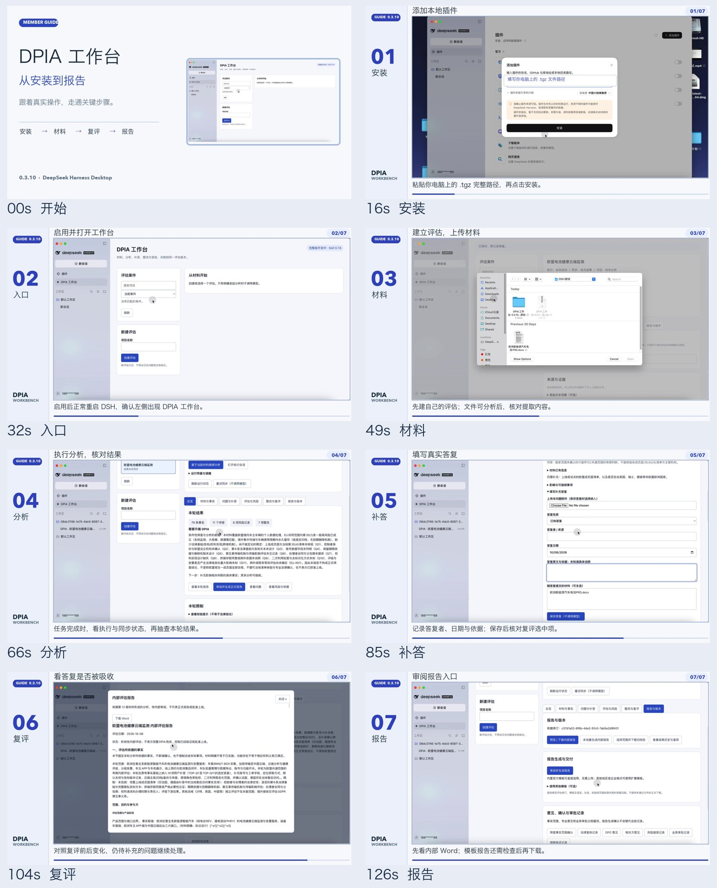

# DSH DPIA Workbench / DPIA 工作台

> **Pre-release v0.3.11-beta.6 (AGPL-3.0-only).** Read the [release notes](https://github.com/The-Data-Galaxy/dsh-dpia-workbench/releases/tag/v0.3.11-beta.6) and limits below before installing.

**License note:** beta.6 uses `AGPL-3.0-only` for original project material. The earlier beta.5 tag and archive remain Apache-2.0. See [License and third-party materials](#license-and-third-party-materials--许可与第三方素材).

A DeepSeek Harness bundle for versioned data protection impact assessments. It keeps source material and fact corrections, supports follow-up questions and reassessment, and prepares reviewable reports with a record of versions and outstanding decisions.

这是一个用于 DeepSeek Harness 的 DPIA 工作台插件：保留材料来源与事实修订，支持补答复评，并生成带版本和未决事项记录的报告。

Created and maintained by **[朱玲凤](https://xingchendata.com/)** · [个人网站「那一片数据星辰」](https://xingchendata.com/).

## What it does / 产品特点

- **Trace facts to sources / 事实可追溯：** Keep source material, source locations and fact corrections together; distinguish a proposed design from confirmed implementation.
- **Continue questions and reassess / 问题可接续：** Record answers and evidence, reassess after new material, and review changes and remaining gaps.
- **Separate risk, action and approval / 风险与整改分开记录：** Track measures and verification evidence while keeping professional review and business approval with people.
- **Review reports by version / 报告带版本边界：** Preserve the basis, version and unresolved items; show blocking conditions when a formal report is not yet supported.

## Demo video / 演示视频

[Watch the 2-minute Chinese walkthrough on YouTube / 在线播放中文演示](https://youtu.be/KpXfrbogNZ0). It uses a synthetic example and shows the **0.3.10** interface: installation, materials, analysis results, follow-up answers, reassessment and the report entry. It does not show a completed formal report or download. Use the beta.6 installation instructions below; the video shows an older local `.tgz` installation.

这段视频使用合成案例，画面录于 **0.3.10**；只展示到报告入口，没有拍摄正式报告生成或下载。安装当前 beta.6 请以本仓库命令为准。



## Current evidence / 当前证据

- Published pre-release: **0.3.11-beta.6**. Its runtime JavaScript and test logic are unchanged from beta.5; this version updates the license, documentation, and version metadata. See the matching release notes for artifact checks.
- The installed **0.3.10** baseline passed a real-host saved-result and refresh replay with DeepSeek Harness Desktop **0.2.0-rc.2** on macOS; its internal automated suite ended with 111 passing checks. That evidence does not certify the later source candidate.
- The previous beta.5 archive installed in a new isolated DSH web profile. In Safari, the plugin entry and empty state appeared; a synthetic assessment was created and reopened after refresh without configuring a model key. No analysis or report was run. That host result is reused for unchanged runtime code; beta.6 has not received a separate host installation smoke test.
- Installation on another machine, Windows compatibility, and full-page layout of long reports have not been established by this evidence.

## Workflow / 使用流程

1. Create an assessment and import permitted project material. Review facts alongside their sources.
2. Start analysis in a dedicated DSH session. Saving material alone does not call a model.
3. Record corrections, answers, actions and review decisions. Saving an answer does not mark a question resolved.
4. Reassess against a new material revision. Review the changes and remaining gaps.
5. Generate an internal report or a clearly marked draft/formal document when the applicable gates are met.

新建评估并导入获准材料 → 核对事实与来源 → 在专用 DSH 会话分析 → 补答和复评 → 核对风险、整改及未决事项 → 生成相应状态的报告。

## License and third-party materials / 许可与第三方素材

On the current `main` branch, original plugin code and project-authored documentation use [GNU AGPL v3.0 only](LICENSE) (`AGPL-3.0-only`). The already published `v0.3.11-beta.5` tag and release archive remain under Apache-2.0; that earlier grant is not withdrawn. The EDPB original template and its unofficial Chinese working translation are listed in [NOTICE](NOTICE) and are not relicensed under AGPL. The project owner confirmed redistribution rights for the translation on 2026-10-14.

当前 `main` 分支的原创插件代码及项目自制说明采用 GNU AGPL v3.0 only（`AGPL-3.0-only`）。已发布的 `v0.3.11-beta.5` 标签和归档仍按 Apache-2.0 提供，既有授权不追溯撤回。EDPB 原模板与非官方中文工作译本按 NOTICE 单独标注，不因随包提供而变为 AGPL 素材；项目负责人已确认译本可公开再分发。

## Data and limits / 数据与限制

Assessment files are stored as plaintext on the local machine, under `~/.dsh/dpia-workbench` by default (or the configured DSH data directory). When analysis is started, the relevant material is sent through the user's configured DSH model workflow. The plugin does not replace professional review or approve a processing activity.

评估文件默认在本机明文保存；启动分析后，相关材料会进入用户配置的 DSH 模型流程。插件不会代替专业复核，也不会自动批准处理活动。

The bundled EDPB template is tracked as a consultation version unless its current official status is verified. The Chinese working translation is unofficial. Neither is an EDPB endorsement of this plugin.

内置 EDPB 模板须按核验时的官方状态标识；中文工作译本不是官方译本。插件不代表 EDPB 背书。

## Runtime requirements / 运行依赖

The bundled Skill needs Python 3.9+. Document extraction and report checks need `python-docx` with native comment support and `pypdf`; PDF template work also needs `reportlab` and a compatible `pdftoppm`. Report rendering uses an executable selected by `DSH_DPIA_RENDERER`, or the current user's `~/.local/bin/codex-render-docx`. It must accept the plugin's DOCX rendering arguments and produce the expected PDF and page images. The plugin reports missing dependencies instead of installing them automatically. Installation and report rendering outside the development Mac are unverified.

内置 Skill 需要 Python 3.9+。文档提取与检查需要支持原生批注的 `python-docx` 和 `pypdf`；PDF 模板还需 `reportlab` 与兼容的 `pdftoppm`。报告渲染使用 `DSH_DPIA_RENDERER` 指定的可执行程序，或当前用户目录下的默认入口。插件不会自动安装这些依赖；开发机以外的完整安装仍待验证。

## Tests / 测试

The `test/` directory contains nine files adapted from the internal suite that do not depend on private cases or absolute development paths. The beta.3 standalone suite ran once: 46 Node checks and 17 template-preservation checks passed; the native-PDF group initially passed 3/4, with one test failing because it still wrote to an internal evidence path. After removing that test-only path, only the failed test was rerun and passed. Thus 67 distinct checks passed with none skipped, although the initial suite run was not all green. The beta.6 runtime and test logic are unchanged from that corrected beta.3 candidate. See the matching release notes for artifact-specific checks; internal tests requiring local cases, scripts or Codex runtimes were intentionally left out. See [CONTRIBUTING.md](CONTRIBUTING.md) for focused commands.

`test/` 保留九个不依赖内部案例或个人绝对路径的测试文件。beta.3 独立全组仅运行一次，最终 67 项各通过、0 跳过；原生 PDF 组初次有一项测试夹具残留内部路径，修正后只复验该失败项。beta.6 的运行时与修正后的测试逻辑不变；对应标签的制品核验结果以发布说明为准。

## Installation / 安装

Use a DSH profile whose existing plugins and data have been backed up. Install from the published GitHub tag, or install the exact release archive from its local path. Then start that profile:

```sh
dsh plugin --profile web add github:The-Data-Galaxy/dsh-dpia-workbench#v0.3.11-beta.6
# Or: dsh plugin --profile web add /absolute/path/dsh-dpia-workbench-0.3.11-beta.6.tgz
dsh --profile web
```

Replace `web` with the intended profile. Installing the plugin does not start an assessment or call a model. To roll back, reinstall the previously verified archive. Assessment files are separate from the bundle; back them up before changing profiles or versions. Do not delete the data directory when removing the plugin.

请先备份目标 DSH profile 的插件与数据；按已公开的精确版本安装并启动该 profile。`web` 可替换为实际 profile 名称。安装本身不会启动评估或调用模型；回退时重装先前验证过的包，保留并事先备份评估数据。
